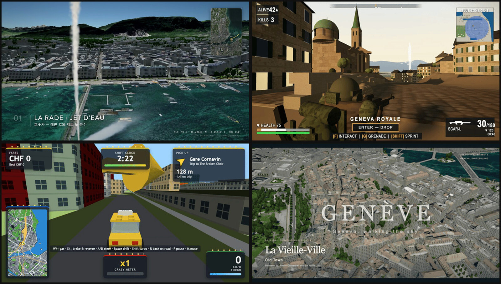

# Geneva bench

Same prompt, many AI coding agents, one shot each. Every model was asked to build something set in Geneva (LEGO city, drone flight, battle royale, Crazy Taxi) and the output is published as-is.

**Live site: https://geneva-bench.pages.dev** (every result below is playable in the browser)



_Top left to bottom right: Claude Opus 5.5 drone flight (T2), Muse Wonder Full battle royale (T3), Claude Haiku 5.5 Crazy Taxi (T4), GPT-6.1 Sol Old Town flyover (T2)._

## How it was run

- One run per model, no human fixes. Outputs are untouched apart from hosting path fixes.
- T3/T4: max reasoning effort, each model in its own fresh macOS VM, non-interactive CLI, prompt ends with "Do not ask questions. Make your own decisions and carry it through to the end."
- T1/T2: same prompt per model (originally in Korean), each model's maximum reasoning effort.
- Times are wall-clock. Cost is listed only for API runs; subscription runs (Grok CLI, Z.AI) have no per-run cost.
- "resumed" runs were killed by a host restart on 10/19 and finished in the same session.
- Mix A2 ran on Claude Code cloud (Linux), so it is a harness/platform comparison, not a controlled model-only one. Its setup scaffold is in [`t4/mixA2-cloud/harness/`](./t4/mixA2-cloud/harness/).

## T1: LEGO city

> Make a motion graphic showing Geneva's Old Town, lakeside, central station, UN, Place de Neuve, and Bastions built from LEGO bricks. (original prompt in Korean)

_Reasoning effort high · interactive run · 3 models_

| Model | Harness | Time / cost | Links |
|---|---|---|---|
| Gemini 4 Argon high | opencode | ~30 min · 77.5k output tokens | [play](https://geneva-bench.pages.dev/t1/argon/) · [source](./t1/argon/) |
| Claude Opus 5.5 | Claude Code | ~33 min · 186k output tokens | [play](https://geneva-bench.pages.dev/t1/opus/) · [source](./t1/opus/) |
| GPT-6.1 Sol | Codex CLI | 10 min 3 s · 26.7k output tokens | [play](https://geneva-bench.pages.dev/t1/sol/) · [source](./t1/sol/) |

## T3: Battle royale game

> Build a PUBG-style battle royale game whose map is Geneva: the Old Town, the lakefront, Place de Neuve, and the Parc des Bastions. Do not ask questions. Make your own decisions and carry it through to the end.

_Max reasoning effort · each model in its own fresh macOS VM · non-interactive CLI · one run, no fixes_

| Model | Harness | Time / cost | Links |
|---|---|---|---|
| Muse Wonder Full | Muse CLI | ~5 h active | [play](https://geneva-bench.pages.dev/t3/muse-wonder-full/) · [source](./t3/muse-wonder-full/) |
| Claude Opus 5.5 | Claude Code | resumed · $60.95 | [play](https://geneva-bench.pages.dev/t3/opus55/) · [source](./t3/opus55/) |
| Grok 4.7 xhigh | Grok CLI | resumed · $4.00 | [play](https://geneva-bench.pages.dev/t3/grok47/) · [source](./t3/grok47/) |
| Claude Haiku 5.5 | Claude Code | 59 min · $3.38 | [play](https://geneva-bench.pages.dev/t3/haiku55/) · [source](./t3/haiku55/) |
| GLM 5.3 Flash | ZCode CLI | 45 min | [play](https://geneva-bench.pages.dev/t3/glm53flash-zcode/) · [source](./t3/glm53flash-zcode/) |
| GPT-6.1 Sol | Codex CLI | 32 min · 84k output tokens | [play](https://geneva-bench.pages.dev/t3/sol61/) · [source](./t3/sol61/) |
| GPT-6 Astra | Codex CLI | 29 min · 63k output tokens | [play](https://geneva-bench.pages.dev/t3/astra6/) · [source](./t3/astra6/) |
| Beam | opencode | 9 min | [play](https://geneva-bench.pages.dev/t3/beam-ollama/) · [source](./t3/beam-ollama/) |
| GPT-6 Luna | Codex CLI | 9 min · 60k output tokens | [play](https://geneva-bench.pages.dev/t3/luna6/) · [source](./t3/luna6/) |

## T4: LEGO Crazy Taxi

> Build a LEGO-style Crazy Taxi game in Geneva: drive a LEGO taxi, pick up passengers and race them to Gare Cornavin, the Broken Chair, the Bains des Pâquis, the Pont du Mont-Blanc, the Jet d'Eau, the Jardin Anglais, Place Bel-Air, the Old Town, Place de Neuve, and the Parc des Bastions, laid out at their real relative positions and distances. Do not ask questions. Make your own decisions and carry it through to the end.

_Max reasoning effort · each model in its own fresh macOS VM · non-interactive CLI · one run, no fixes_

| Model | Harness | Time / cost | Links |
|---|---|---|---|
| Claude Opus 5.5 | Claude Code | 2 h 20 min · $54.26 | [play](https://geneva-bench.pages.dev/t4/opus55/) · [source](./t4/opus55/) |
| Claude Sonnet 5.5 | Claude Code | 3 h 1 min · $31.04 | [play](https://geneva-bench.pages.dev/t4/sonnet55/) · [source](./t4/sonnet55/) |
| DeepSeek V4.1 Flash | DeepSeek Harness | 73 min · API, under $1 | [play](https://geneva-bench.pages.dev/t4/dsh-flash1017/) · [source](./t4/dsh-flash1017/) |
| Grok 4.7 xhigh | Grok CLI | 58 min · $8.64 | [play](https://geneva-bench.pages.dev/t4/grok47/) · [source](./t4/grok47/) |
| Claude Haiku 5.5 | Claude Code | 50 min · $3.18 | [play](https://geneva-bench.pages.dev/t4/haiku55/) · [source](./t4/haiku55/) |
| GLM 5.3 Flash | ZCode CLI | 49 min | [play](https://geneva-bench.pages.dev/t4/glm53flash-zcode/) · [source](./t4/glm53flash-zcode/) |
| GPT-6.1 Sol | Codex CLI | 29 min · 78k output tokens | [play](https://geneva-bench.pages.dev/t4/sol61/) · [source](./t4/sol61/) |
| GPT-6 Astra | Codex CLI | 28 min · 66k output tokens | [play](https://geneva-bench.pages.dev/t4/astra6/) · [source](./t4/astra6/) |
| Beam | opencode | 14 min | [play](https://geneva-bench.pages.dev/t4/beam-ollama/) · [source](./t4/beam-ollama/) |
| GPT-6 Luna | Codex CLI | 10 min · 73k output tokens | [play](https://geneva-bench.pages.dev/t4/luna6/) · [source](./t4/luna6/) |
| Mix B: DeepSeek V4.1 Flash lead + Claude Opus 5.5 helper | DeepSeek Harness + Claude Code subagent | 74 min · DeepSeek 516k output tokens · Opus called 2× | [play](https://geneva-bench.pages.dev/t4/mixB-dsflash-opus/) · [source](./t4/mixB-dsflash-opus/) |
| Mix A2: Claude Opus 5.5 lead + DeepSeek V4.1 Flash helper | Claude Code cloud (Linux), separate experiment | ~2 h 35 min · $95.46 · DeepSeek review timed out | [play](https://geneva-bench.pages.dev/t4/mixA2-cloud/) · [source](./t4/mixA2-cloud/) |

## T2: Drone flight

> Make a 3D video flying a drone view over Geneva's Old Town, lakeside, central station, UN, Place de Neuve, and Bastions. (original prompt in Korean)

_Max reasoning effort per model · non-interactive run · finished models only_

| Model | Harness | Time / cost | Links |
|---|---|---|---|
| Gemini 4 Argon high | opencode | 29 min · 83k tokens · $3.01 | [play](https://geneva-bench.pages.dev/t2/argon/) · [source](./t2/argon/) |
| Claude Opus 5.5 | Claude Code | 297 min · $97 | [play](https://geneva-bench.pages.dev/t2/opus55/) · [source](./t2/opus55/) |
| GPT-6 Astra xhigh | Codex CLI | 17 min · 40k tokens | [play](https://geneva-bench.pages.dev/t2/astra/live/) · [source](./t2/astra/live/) |
| GPT-6.1 Sol xhigh | Codex CLI | 22 min · 52k tokens | [play](https://geneva-bench.pages.dev/t2/sol61/live/) · [source](./t2/sol61/live/) |
| DeepSeek 4.1 Flash | opencode | 106 min · 248k tokens · $1.23 | [play](https://geneva-bench.pages.dev/t2/deepseek41f-venice/) · [source](./t2/deepseek41f-venice/) |
| GLM 5.3 | opencode | 30 min · 60k tokens | [play](https://geneva-bench.pages.dev/t2/glm53/) · [source](./t2/glm53/) |
| Qwen 3.8 Flash xhigh | opencode | 41 min · 104k tokens · $0.19 | [play](https://geneva-bench.pages.dev/t2/qwen38flash/) · [source](./t2/qwen38flash/) |
| Grok 4.7 xhigh | Grok CLI | 75 min · 207k tokens | [play](https://geneva-bench.pages.dev/t2/grok47/) · [source](./t2/grok47/) |
| GLM 5.3 Flash | opencode | 84 min · 114k tokens | [play](https://geneva-bench.pages.dev/t2/glm53flash/) · [source](./t2/glm53flash/) |
| Muse Spark 1.3 xhigh | opencode | 9 min · 31k tokens · $0.02 | [play](https://geneva-bench.pages.dev/t2/muse13/) · [source](./t2/muse13/) |
| Gemini 3.8 Flash high | Antigravity CLI | 8 min · 325k tokens | [play](https://geneva-bench.pages.dev/t2/gem38flash/) · [source](./t2/gem38flash/) |

## Layout

```
index.html      landing page (same as the live site)
gif/            ~10 s preview captures
t1..t4/<model>/ each model's output, served at /<task>/<model>/
```

Preview GIFs are short captures of the result or clips from the model's own video. Videos over 25 MB could not be hosted on Pages, so the GIF stands in.
